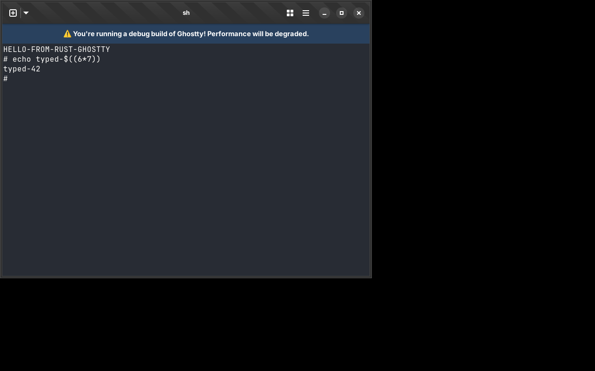

# ghostty-rs

A file-for-file port of the Ghostty terminal emulator from Zig to Rust
(reference revision `93967b7`). Credits and licenses are in
[NOTICE.md](../NOTICE.md).

This checkout includes bulk terminal-write optimizations, portable terminal
tests, a `lib-vt` Cargo feature that builds only the terminal library, and
zz's additions to the C API: `ghostty_terminal_clone_screen` (copy-on-write
screen snapshots), `ghostty_render_state_row_cells_copy` with render state
clips and trimmed row copies, spare-page reuse, and hyperlink row-copy reuse.
`include/` matches zz's vendored Ghostty headers.



Every `ghostty/src/**/*.zig` (and `ghostty/pkg/**/*.zig`) file has a Rust
counterpart at the mirrored snake_case path, e.g. `src/terminal/PageList.zig`
→ `src/terminal/page_list.rs`, with its tests ported alongside. See
[PORTING.md](../PORTING.md) for the conventions and `PORTING_STATUS.tsv` for the
full file mapping.

## Building and running (Linux)

System libraries: GTK 4, libadwaita, FreeType, HarfBuzz, fontconfig,
Oniguruma, EGL/GL. On Debian/Ubuntu:

```sh
sudo apt install libgtk-4-dev libadwaita-1-dev libfreetype-dev libharfbuzz-dev \
  libfontconfig-dev libonig-dev libegl-dev
cargo run --release              # the GTK terminal
cargo run --release -- +version  # CLI actions work as in Ghostty
cargo test --lib                 # the ported test suite
```

`cargo build --no-default-features --features app` builds without the GTK
runtime.
`--features inspector` enables the Dear ImGui terminal inspector.
`ghostty-bench` and `ghostty-gen` are the benchmark and synthetic-data tools;
`ghostty-build-data` generates the terminfo, completion and syntax files.

`tools/install_resources.sh [prefix]` installs the runtime resources (terminfo,
shell integration, themes, completions, vim/bat syntax, translations) into
`<prefix>/share` (default `target/dist/share`), like the Zig build's
`zig-out/share`.

## libghostty-vt

libghostty-vt is Ghostty's standalone terminal library: the `ghostty_*` C API
of `src/terminal/c/` declared in `include/ghostty/vt.h`.
`tools/build_lib_vt.sh [prefix]` builds it like `zig build -Demit-lib-vt`
(only a C compiler, binutils and cargo are needed; no GTK, FreeType or
fontconfig) and installs, Zig-style:

```
<prefix>/lib/libghostty-vt.so.0.1.0   (soname libghostty-vt.so.0, + .so.0/.so symlinks)
<prefix>/lib/libghostty-vt.a
<prefix>/include/ghostty/vt.h, include/ghostty/vt/*.h
<prefix>/share/pkgconfig/libghostty-vt.pc, libghostty-vt-static.pc
```

The default prefix is `target/lib-vt/out`; `--debug` builds the dev profile
and `GHOSTTY_LIB_VT_VERSION` overrides the version (Zig's
`-Dlib-version-string`). Both libraries export only the libghostty-vt C API
(207 functions, the same set as zz's Zig library): the crate is built as a
`staticlib` into `target/lib-vt` with the lib-vt terminal options (no tmux
control mode, version 0.1.0-dev), partially linked with `--gc-sections`
from those functions, and every other symbol is made local. The normal
`cargo build` is unaffected.

```sh
tools/build_lib_vt.sh /usr/local
export PKG_CONFIG_PATH=/usr/local/share/pkgconfig
cc app.c $(pkg-config --cflags --libs libghostty-vt)                            # shared
cc -DGHOSTTY_STATIC app.c $(pkg-config --cflags --static --libs libghostty-vt-static)  # static
```

Rust projects can depend on the crate directly and link the C API from it
instead of a separate libghostty-vt build:

```toml
ghostty = { path = "../ghostty-rs", default-features = false, features = ["lib-vt"] }
```

The `lib-vt` feature selects the lib-vt terminal options, and without the
default `app` feature only the terminal, its C API and the few pieces of
`input`, `font`, `os` and `renderer` it reaches are compiled: no app, apprt,
renderer, config or embedding API (`ghostty_app_*`, `ghostty_surface_*`,
...), no pkg-config, C compiler or system libraries. The `ghostty_*`
functions are defined in the rlib; a crate that only declares them in an
`extern "C"` block must still name the crate (`use ghostty as _;`) so it is
linked.

CMake projects can use `CMakeLists.txt` (the upstream wrapper, driving cargo):
`FetchContent` / `add_subdirectory` gives the `ghostty-vt` and
`ghostty-vt-static` targets, `cmake --install` plus `find_package(ghostty-vt)`
gives `ghostty-vt::ghostty-vt`.

`example/` holds upstream's C/C++ examples; `example/build_all.sh` builds the
library, compiles every example against it with pkg-config (and the CMake
examples with CMake) and runs them (`--prefix <dir>` runs them against
another installed libghostty-vt, e.g. Zig's, for comparison). The Zig API
examples are Rust examples of the crate's API:
`cargo run --example vt`, `cargo run --example vt_stream`,
`printf '\e[31mred\n' | cargo run --example formatter`.

## Terminal library and tests on macOS

Build the standalone static library without app dependencies:

```sh
CARGO_TARGET_DIR=target/lib-vt \
  cargo rustc --release --no-default-features --features lib-vt --lib --crate-type staticlib
```

The archive is `target/lib-vt/release/libghostty.a`. The existing
`tools/build_lib_vt.sh` packaging script targets Linux/ELF.

The terminal and decoder tests need nothing else in lib-vt mode:

```sh
cargo test --no-default-features --features lib-vt --lib terminal::
cargo test --no-default-features --features lib-vt --lib simd::vt::
```

With the app (`--features app`), the test target needs the static gettext
archive on macOS:

```sh
RUSTFLAGS="${RUSTFLAGS:-} -C link-arg=$(brew --prefix gettext)/lib/libintl.a -l dylib=iconv -C link-arg=-framework -C link-arg=CoreFoundation" \
  cargo test --no-default-features --features app --lib terminal::
```

## The macOS app

`macos/` is Ghostty's Swift/AppKit app, unchanged except that it bundles
resources from `target/dist/share`. It links `GhosttyKit.xcframework`, the
libghostty C API (`include/ghostty.h`), which the Rust port provides through
`src/apprt/embedded.rs` and `src/main_c.rs`. On macOS with Xcode:

```sh
brew install pkg-config freetype harfbuzz fontconfig oniguruma
tools/install_resources.sh               # target/dist/share
tools/build_xcframework.sh native        # or: universal (arm64 + x86_64)
macos/build.nu --configuration Debug     # -> macos/build/Debug/Ghostty.app
```

`tools/build_xcframework.sh` replaces `zig build -Demit-macos-app=false`.

## Testing

- `cargo test --no-default-features --features lib-vt --lib terminal::`:
  terminal unit tests (`--features app` for the app build options).
- `cargo test --no-default-features --features lib-vt --lib simd::vt::`:
  decoder unit tests.
- `test/esctest/run.sh`: esctest conformance tests for libghostty-vt.
- `test/fuzz-libghostty`: fuzz harnesses and committed regression corpora.
- `example/build_all.sh`: build and run the C/C++ API examples.

## Progress

```sh
python3 tools/status.py      # summary
python3 tools/status.py -v   # per file
```

Each Rust file's header says `STATUS: ported`, `partial — ...`, or
`not yet ported`; every Zig file is now ported. macOS code (Metal, CoreText,
the embedded apprt) is ported and type-checks with
`cargo check --target x86_64-apple-darwin`, but has not been run, and the
Swift app has not been built against the Rust library yet.

## Working with the reference source

```sh
git clone https://github.com/ghostty-org/ghostty.git ghostty
git -C ghostty checkout 93967b7f9478e94dcbb42125c8a90f34feb40d75
```
